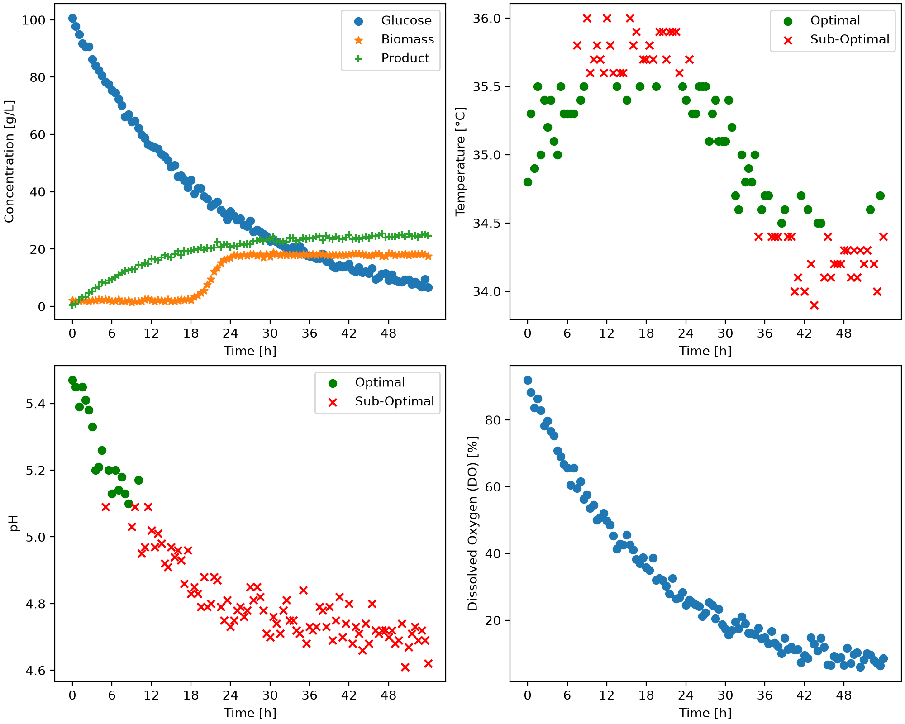

# Repository Structure

`Project Name/`: Fermentation Batch Monitoring Process

`Overview/`: The goals and objectives of this project is to extract batch information from a fermentation dataset, identify which batches fall within the acceptable operating ranges, and generate dashboard figures and summary tables to visualize the data and interpret the results.

`Features/`:  Bioprocess Monitor class is designed to extract and analyze data from a fermentation dataset and determines which of the batches fits within the acceptable pH and temperature ranges. The class will load the dataset and checks each batch to determine how often each batch stays within the acceptable limits. Then it generates a summary for every batch which includes the percent of time in the optimal ranges and the final product values. These results are exported as summary tables the program also generates scatter plots to easily visualize how each batch behaves.

`Technologies used/`: This project uses pandas for data extraction and analysis and matplotlib for generating dashboards and visualizing batch behavior.

`Code design`:
def __init_ Is used to define the filepath, ph_lims, and temperature_lims. the pH and temperature limits are defined are tuples because they both contain two values consisting of an upper and lower limit. The [0] and [1] refers to the lower and upper limits provide in main.py. Furthermore, the dataset is read using the pd.read_csv() and stored as self.df which allows the other parts of the code to access the data. The def extract_batch is then used to select the data corresponding to a specific batch. The def optimal_temperature_mask and optimal_ph_mask is used to determine whether the batch falls within the operating range and returns a boolean mask which identifies whether each measurement is within the acceptable range. Following the def get_n_batches determines the number of unique batches within the fermentation dataset and returns the value. The def export_dashboard uses the results to create a 2 x 2 scatter plot for each batch and the def export_dashboard calculates the percentage of measurements for each batch that fall within the acceptable pH and temperature limits and records the final product concentration for each batch. The results are then exported as PNG figures and CSV summary tables. 

`Dashboard`: The following dashboard represents results from batch 5 mode B. The scatter plot top left represents a concentration versus time plot where glucose, biomass, and product concentrations are shown with their respective color and marker. The top right plot represents the temperature versus time plot where measurements within the acceptable temperature range are marked as "optimal" with a green circle, and the measurements outside the acceptable temperature range are marked as "suboptimal" with a red x. Bottom left plot represents that pH versus time scatter plot which shows which measurements fall within the acceptable pH range. The measurements within the acceptable range are marked as "optimal" with a green circe, and the measurements that fall outside the acceptable operating range and maker "suboptimal" with a red x. Finally, the bottom right plot represents the dissolved oxygen versus time plot.

`Summary table`: The following summary table demonstrates the percentage of measurements that fall within the acceptable pH and temperature range, as well as the final product concentration for each batch. As shown in the table, the batch with the most measurements that fall within the optimal pH and temperature range is batch 4. The batch with the highest product concentration is batch 2. 
|batch_id|pH_optimal_percent|temperature_optimal_percent|C_product_g_L^-1|
|--------|------------------|---------------------------|----------------|
|1.0     |36.08             |51.55                      |46.5            |
|2.0     |34.71             |55.37                      |50.8            |
|3.0     |36.99             |46.58                      |44.6            |
|4.0     |54.12             |62.35                      |48.6            |
|5.0     |16.51             |49.54                      |24.7            |

